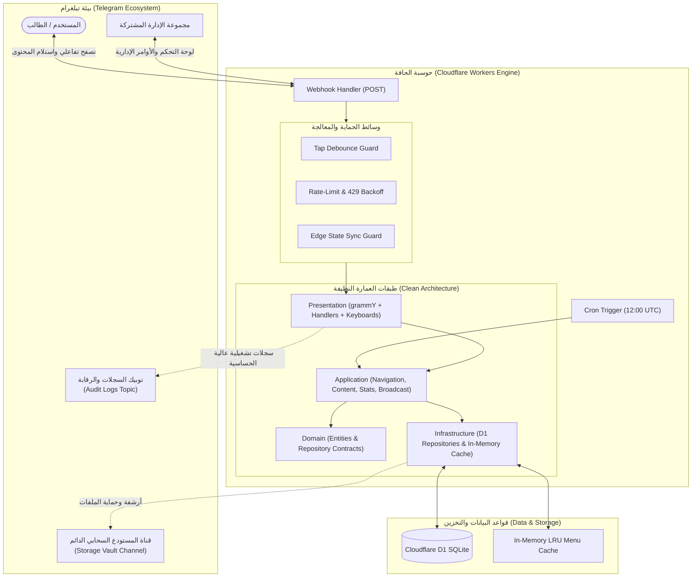

# ⚡ EdgeBot Blueprint: Production Serverless Telegram Bot Framework

> **قالب معماري متكامل (Production-Ready Blueprint & Starter Kit) لبناء روبوتات تيلغرام سحابية فائقة الأداء، تعمل بالكامل على حافة الشبكة (Serverless Edge Computing) بدون خوادم تقليدية، باستخدام TypeScript و grammY و Cloudflare Workers و Cloudflare D1 (SQLite) وفق مبادئ العمارة النظيفة (Clean Architecture).**

[](https://www.typescriptlang.org/)
[](https://workers.cloudflare.com/)
[](https://developers.cloudflare.com/d1/)
[](https://grammy.dev/)
[](https://blog.cleancoder.com/uncle-bob/2012/08/13/the-clean-architecture.html)
[](https://opensource.org/licenses/MIT)

---

## 🌟 لماذا هذا القالب؟ (Why This Blueprint?)

تم بناء هذا المشروع ليكون **الأساس المعماري الصلب (Blueprint & Foundation)** لأي مطور أو فريق يريد إطلاق بوت تيلغرام احترافي سريع وموثوق دون الدخول في دوامة إعداد الخوادم (VPS)، أو شهادات SSL، أو قواعد البيانات الخارجية، أو مواجهة مشاكل انهيار الذاكرة وتكاليف الاستضافة الدورية:

- **تكلفة تشغيل 0$**: مؤهل بنسبة 100% للعمل ضمن الخطة المجانية لـ Cloudflare (تشمل Workers و D1).
- **استجابة لحظية (< 50ms)**: يعمل الكود مباشرة في أكثر من 300 مركز بيانات حول العالم قرب مستخدمي البوت وخوادم تيلغرام (Smart Placement).
- **قالب عام وقابل لإعادة التخصيص بالكامل**: صُمم النظام ليدير شجرة قوائم ومحتوى متداخلة لأي مجال تريده دون المساس بنواة النظام.
- **صمود وموثوقية إنتاجية**: يتضمن آليات حماية متقدمة ضد الضغط المتزامن (Tap Debouncing)، ومعالجة حدود تيلغرام (429 Rate Limiting)، وتزامن الحالة بين بيئات العزل السحابية (Edge State Isolation).

---

## 🎯 حالات الاستخدام الشائعة (Common Use Cases)

يمكنك توظيف هذا القالب خلال دقائق ليتحول إلى:

| المجال | مثال تطبيقي |
| :--- | :--- |
| 🎓 **المنصات التعليمية والدورات** | تنظيم المناهج الدراسية، المحاضرات، بنوك الأسئلة، وملفات الـ PDF والتسجيلات الصوتية في قوائم متفرعة. |
| 🛍️ **المتاجر الرقمية والكتالوجات** | استعراض الأقسام، كتالوجات المنتجات، المواصفات الفنية، الروابط، وتفاصيل الطلب. |
| 🏢 **بوابات الشركات والدعم الفني** | إجابات الأسئلة الشائعة (FAQ)، الأدلة التعريفية، روابط الخدمات، وتوجيه العملاء. |
| 📚 **المكتبات الرقمية ومستودعات الوسائط** | أرشفة الكتب والملفات الكبيرة (حتى 2GB للملف) مع محرك تسليم دائم وفوري. |
| 📢 **منصات إدارة المجتمعات والإذاعة** | إدارة المشتركين، إحصائيات التفاعل، وإرسال تعميمات جماعية مجدولة وآمنة. |

---

## 🏛️ المخطط المعماري للنظام (System Architecture)



---

## 🚀 الركائز التقنية الأساسية (Core Technical Pillars)

### 1. 🏗️ العمارة النظيفة (Clean Architecture)
النظام مفصول بدقة إلى 4 طبقات مستقلة تماماً:
- **`Domain`**: الكيانات النقية (`MenuNode`, `NodeContent`, `BotUser`, `AdminSession`) وعقود المستودعات (`IRepository`). لا تعتمد على أي مكتبة خارجية.
- **`Application`**: منطق الأعمال وحالات الاستخدام (`MenuNavigationService`, `ContentAdminService`, `StatsAndBroadcastService`).
- **`Infrastructure`**: التنفيذ الفعلي لقواعد البيانات السحابية عبر `Cloudflare D1`، إعدادات البيئة `Env`، ونظام الذاكرة المؤقتة `TreeMemoryCache`.
- **`Presentation`**: معالجات إطار `grammY`، بناء الأزرار الذكية، حراس الصلاحيات، وآليات تسليم المحتوى.

### 2. ⚡ التزامن وحماية الحافة (Edge State Isolation & UX Resilience)
- **مقاومة تلاشي الذاكرة (Anti-Desync)**: نظراً لأن خوادم الحافة (Cloudflare Isolates) لا تشارك الذاكرة العشوائية وتُنشأ وتُحذف بسرعة، تم نقل حفظ مسار المستخدم وحالته التصفحية بالكامل إلى D1 (`user_navigation_state`) لضمان عدم حدوث أي خلل في أزرار الرجوع أو التنقل.
- **حماية النقر المتعدد (Per-User Tap Debounce)**: وسيط برمجي يمنع تكرار معالجة الضغطات المزدوجة السريعة على الأزرار ويحمي النظام من هجمات السبام وتضارب الحالات.
- **معالجة خطأ 429 بلباقة (Graceful 429 Backoff)**: التعامل التلقائي مع قيود تيلغرام وإعادة المحاولة مع تأخير زمني أسي (Exponential Backoff).
- **كبح سجلات التحذير (Log Throttling)**: حماية توبيك الإدارة من الفيضان التكراري للسجلات التشغيلية المتشابهة.

### 3. 📦 محرك التسليم المزدوج ومستودع الأرشيف الدائم (Dual Delivery & Vault Storage)
- **قناة الأرشيف المحمية (`Storage Vault Channel`)**: قناة خاصة لا يدخلها المستخدمون، تُحفظ فيها جميع الملفات والوسائط فور رفعها.
- **التسليم باسم البوت (`copyMessage`)**: للملفات والرسائل الخاصة بالمنصة (`is_forwarded = 0`) لتظهر تحت هوية البوت مباشرة.
- **حفظ حقوق المصدر الأصلي (`forwardMessage`)**: للملفات المحولة من قنوات أخرى (`is_forwarded = 1`) لإظهار المصدر تقديراً لحقوق النشر.
- **محرك الصمود الثلاثي (Triple Fallback)**: في حال تم حذف الرسالة الأصلية، يعتمد البوت تلقائياً على معرّف الملف `file_id` المخزن احتياطياً في D1 لتسليم الملف بسلاسة تامة دون شعور المستخدم بأي انقطاع.

---

## 🎨 دليل تخصيص القالب لمشروعك (Blueprint Customization Guide)

### كيف تبني شجرة القوائم الخاصة بك؟ (How to Build Menus)

يمتلك البوت نظام شجرة قوائم هرمي مرن (`menu_nodes`)؛ كل زر عبارة عن سجل في قاعدة البيانات يحدد عنوانه، ترتيبه، والقسم الأب التابع له:

```
[القائمة الرئيسية]
 ├── [القسم الأول] (parent_id = NULL)
 │    ├── [فرعي 1.1] (parent_id = القسم الأول)
 │    └── [فرعي 1.2]
 └── [القسم الثاني]
      └── [فرعي 2.1]
```

#### الطريقة الأولى: من داخل تيلغرام مباشرة عبر لوحة التحكم (بدون كتابة كود)
1. افتح مجموعة المشرفين المعتمدة واكتب: `/admin` أو `/panel`.
2. اضغط على **➕ إضافة قسم جديد** (أو أرسل قائمة أسطر نصية لإضافة عدة أقسام دفعة واحدة).
3. اضغط على أي زر لإعادة تسميته، أو تحريك ترتيبه للأعلى والأسفل (`⬆️ / ⬇️`)، أو إضافة أقسام فرعية تحته.
4. اضغط على **📥 رفع محتوى** وأرسل الملفات، المستندات، أو الفيديوهات ليتم ربطها فوراً بهذا القسم.
5. اضغط على **👁️ معاينة كـ مستخدم** لتجربة القائمة كما ستظهر لجمهورك.

#### الطريقة الثانية: عبر ملفات الترحيل البرمجية (SQL Migrations)
يمكنك وضع البنية المبدئية لمشروعك عبر كتابة أوامر `INSERT` بسيطة داخل [migrations/0002_seed_initial_tree.sql](file:///D:/Work/BDT_bot/migrations/0002_seed_initial_tree.sql):

```sql
-- المستوى الأول (الرئيسية)
INSERT INTO menu_nodes (id, parent_id, title, sort_order) VALUES
    (1, NULL, '🛍️ الكتالوج الرقمي', 1),
    (2, NULL, '💡 خدماتنا', 2),
    (3, NULL, '📞 اتصل بنا', 3);

-- أقسام فرعية تابعة للكتالوج (parent_id = 1)
INSERT INTO menu_nodes (id, parent_id, title, sort_order) VALUES
    (10, 1, '📱 الهواتف الذكية', 1),
    (11, 1, '💻 الحواسيب المحمولة', 2);
```

---

## 📂 بنية المشروع البرمجية (Project Directory Structure)

```text
BDT_bot/
├── migrations/                                # ملفات بناء وترقية قاعدة بيانات D1
│   ├── 0001_initial_schema.sql                # الجداول الأساسية (الأقسام، المحتويات، الجلسات)
│   ├── 0002_seed_initial_tree.sql             # بذور الشجرة المبدئية (قابلة للتخصيص)
│   ├── 0003_users_and_stats.sql               # جداول إحصائيات المشتركين والزيارات
│   ├── 0004_user_navigation_state.sql         # حالة التصفح الحالية لكل مستخدم لمنع التعليق
│   ├── 0005_button_layout.sql                 # إعدادات مصفوفات وتوزيع الأزرار
│   ├── 0006_content_is_forwarded.sql          # تصنيف نوع تسليم المحتوى (مباشر / محول)
│   └── 0007_vault_message_id.sql              # معرّفات رسائل قناة الأرشيف السحابي
├── scripts/
│   └── export_users.py                        # أداة التصدير السحابية الفائقة (JSON / Excel / PDF)
├── src/
│   ├── domain/                                # طبقة الكيانات والعقود المستقلة
│   │   ├── entities/                          # MenuNode, NodeContent, BotUser, AdminSession
│   │   └── repositories/                      # عقود المستودعات البرمجية (Interfaces)
│   ├── application/                           # طبقة حالات الاستخدام ومنطق العمل
│   │   ├── errors/                            # فئات الأخطاء المعيارية AppError
│   │   └── services/                          # Navigation, Content, Stats, Broadcast
│   ├── infrastructure/                        # طبقة التكامل الخارجي وقواعد البيانات
│   │   ├── cache/                             # كاش الذاكرة فائق السرعة TreeMemoryCache
│   │   ├── config/                            # تعريف وحقن متغيرات البيئة Env
│   │   └── database/                          # تطبيق المستودعات باستخدام Cloudflare D1
│   ├── presentation/                          # طبقة التيليغرام وعرض الواجهات
│   │   ├── context/                           # سياق العمل المخصص BotContext
│   │   ├── handlers/                          # معالجات أوامر المستخدمين والمشرفين
│   │   ├── keyboards/                         # مولدات لوحات المفاتيح والـ Inline Buttons
│   │   ├── middlewares/                       # حراس الصلاحيات، منع النقر المتكرر، ومكافحة 429
│   │   ├── utils/                             # أدوات التسليم المزدوج، شريط المزامنة، وسجلات النظام
│   │   └── bot.ts                             # مصنع وتكوين محرك البوت (Bot Factory)
│   └── index.ts                               # نقطة الدخول الرئيسية لـ Cloudflare Worker
├── package.json                               # الحزم وأوامر التشغيل السريعة
├── tsconfig.json                              # إعدادات مترجم TypeScript
└── wrangler.toml                              # ملف ضبط وتعيين خادم الحافة وقاعدة بيانات D1
```

---

## 🗄️ مخطط قاعدة البيانات (D1 Schema Reference)

| الجدول | الدور والوظيفة |
| :--- | :--- |
| `menu_nodes` | تخزين كافة الأقسام والقوائم المتداخلة، ترتيب العرض، وعداد الزيارات الإجمالي. |
| `node_contents` | تخزين الملفات والرسائل والوسائط المرفقة بكل قسم، نوعها، معرّف الرسالة، و`file_id`. |
| `bot_users` | سجل المستخدمين والمشتركين مع توقيت أول وآخر تفاعل لتقديم الإحصائيات والإذاعة العامة. |
| `user_navigation_state` | تتبع المسار الحالي للمستخدم لمنع تضارب الحالات عبر خوادم الحافة المختلفة. |
| `admin_sessions` | إدارة آلة الحالة (State Machine) لعمليات المشرفين أثناء الرفع والتعديل التفاعلي. |

---

## ⚙️ دليل التثبيت والتشغيل خطوة بخطوة (Step-by-Step Setup)

### 1. المتطلبات الأولية
- تثبيت بيئة [Node.js](https://nodejs.org/) (الإصدار 18 أو أحدث).
- حساب مجاني على منصة [Cloudflare](https://dash.cloudflare.com/).
- بوت تيلغرام مفعل عبر [@BotFather](https://t.me/BotFather) والحصول على التوكن (`BOT_TOKEN`).

### 2. استنساخ المشروع وتثبيت الحزم
```bash
git clone https://github.com/your-username/bdt-telegram-bot.git
cd bdt-telegram-bot
npm install
```

### 3. إنشاء قاعدة بيانات Cloudflare D1
نفّذ الأمر التالي لإنشاء قاعدة بياناتك السحابية (يفضل تحديد غرب أوروبا `weur` لقربها من سيرفرات تيلغرام):
```bash
npx wrangler d1 create my-telegram-bot-db --location weur
```
انسخ معرّف `database_id` الناتج وضعه داخل ملف `wrangler.toml`:
```toml
[[d1_databases]]
binding = "DB"
database_name = "my-telegram-bot-db"
database_id = "YOUR_ACTUAL_DATABASE_ID"
migrations_dir = "migrations"
```

### 4. تطبيق ملفات الهيكلة (Database Migrations)
- **محلياً (للتطوير والتجربة)**:
  ```bash
  npm run db:migrate:local
  ```
- **سحابياً (على بيئة الإنتاج في Cloudflare)**:
  ```bash
  npm run db:migrate:remote
  ```

### 5. ضبط المعرفات والمتغيرات (`wrangler.toml` & Secrets)
افتح ملف [wrangler.toml](file:///D:/Work/BDT_bot/wrangler.toml) وحدد المعرفات الخاصة بمجموعاتك:
```toml
[vars]
ADMIN_GROUP_ID = "-100XXXXXXXXXX"        # معرّف مجموعة الإدارة الخارقة (Supergroup)
LOGS_TOPIC_ID = "2074"                   # معرّف توبيك السجلات (إن كانت المجموعة منتدى Forums)
STORAGE_CHANNEL_ID = "-100YYYYYYYYYY"    # معرّف قناة مستودع التخزين الدائم (Vault Channel)
WORKER_URL = "https://your-worker.workers.dev" # رابط الـ Worker بعد النشر
```

قم بإضافة التوكن والمفاتيح السرية المشفرة:
```bash
# توكن البوت الأساسي
npx wrangler secret put BOT_TOKEN

# (اختياري لكن يُنصح به) مفتاح سري لحماية نقطة نهاية Webhook
npx wrangler secret put WEBHOOK_SECRET
```

### 6. نشر الخادم السحابي (Deployment)
```bash
npm run deploy
```

### 7. ربط وتفعيل الـ Webhook بضغطة زر
بعد اكتمال النشر بنجاح، افتح المسار المخصص التالي في متصفحك لربط البوت تلقائياً بتيلغرام وتعيين قائمة الأوامر المعيارية:
```text
https://<YOUR_WORKER_SUBDOMAIN>.workers.dev/setup-webhook
```
*(أو أضف `?secret=YOUR_WEBHOOK_SECRET` في حال قمت بضبط المفتاح السري).*

---

## 📋 دليل الأوامر التفاعلية (Bot Commands Reference)

### 👤 أوامر المستخدمين (في المحادثة الخاصة):
| الأمر | الوصف |
| :--- | :--- |
| `/start` | فتح القائمة الرئيسية، وتسجيل المستخدم في قاعدة البيانات، وبدء التصفح التفاعلي |

### 🛠️ أوامر المشرفين (حصرياً داخل مجموعة الإدارة المعتمدة):
| الأمر | الوصف |
| :--- | :--- |
| `/admin` أو `/panel` | فتح لوحة التحكم التفاعلية لبناء وتعديل الأقسام وتعديل ترتيبها ورفع الوسائط |
| `/sync_vault` | فحص ونقل الملفات الجديدة مباشرة إلى قناة الأرشيف مع شريط تقدم تفاعلي حي |
| `/backup` | تحميل نسخة احتياطية فورية وكاملة لقاعدة بيانات D1 بصيغة ملف SQL بضغطة زر |
| `/health` | فحص استقرار الخادم السحابي، زمن استجابة D1، والاتصال بسيرفرات تيلغرام |
| `/stats` | عرض إحصائيات دقيقة: إجمالي المشتركين، أعداد الأقسام، ونسب مشاهدة المحتوى |
| `/broadcast` | تجهيز وإرسال إذاعة عامة لجميع المشتركين مع شاشة معاينة وتأكيد قبل الإرسال |
| `/tree` | استعراض الخريطة الكاملة لشجرة الأقسام وتفرعاتها الحالية |
| `/id` | استخراج معرّف المحادثة الحالية ومعرّف حساب المستخدم |
| `/cancel` | إلغاء العملية الجارية والخروج من وضع الرفع أو التعديل الإداري |

---

## 📊 أداة تصدير التقارير الذكية (Automated Reporting CLI)

يتضمن القالب أداة برمجية متقدمة في [scripts/export_users.py](file:///D:/Work/BDT_bot/scripts/export_users.py) تتيح لك سحب وتحليل وتصدير بيانات مستخدمي البوت بضغطة واحدة:

```bash
npm run export:users
```

### ما الذي تنجزه هذه الأداة تلقائياً؟
1. **استخراج مباشر من Cloudflare D1**: جلب كافة المستخدمين المسجلين مع معالجة كاملة لترميز **UTF-8** لحفظ النصوص والأسماء العربية والتشكيل والرموز بدقة 100%.
2. **توليد ملف Excel احترافي (`users_data.xlsx`)**:
   - ورقة عمل مزدوجة الأعمدة (`المستخدمون (مزدوج)`) تتضمن مستخدمين في كل سطر لسهولة القراءة والطباعة، مع اتجاه من اليمين لليسار (RTL).
   - ورقة عمل إضافية (`القائمة الكاملة (مفرد)`) للفرز والفلترة المتقدمة.
3. **توليد ملف PDF عالي الدقة (`users_data.pdf`)**:
   - يدعم ربط وتشكيل الحروف العربية واتجاه النص (RTL BiDi) باستخدام محرك تظهير متقدم.
   - تصميم مزدوج أنيق يقلص حجم الصفحات، مع تكرار الترويسات وترقيم الصفحات تلقائياً.
4. **تنظيف آلي**: التخلص فوراً من أي ملفات وسيطة مؤقتة ليبقى المشروع نظيفاً دائماً.

---

## 🔒 الأمان والحماية التشغيلية (Security & Production Hardening)

1. **صمام الأمان المزدوج (`adminGuard`)**: فحص دقيق على مستوى معرّف المجموعة الصارم (`ADMIN_GROUP_ID`) وصلاحيات المشرف، مما يجعل استدعاء أوامر الإدارة من خارج المجموعة أمراً مستحيلاً برمجياً.
2. **التحقق من توقيع Webhook**: دعم الترويسة المشفرة `X-Telegram-Bot-Api-Secret-Token` لضمان أن جميع الطلبات الواردة مصدرها الرسمي والمباشر هو خوادم تيلغرام فقط.
3. **التحكم بمعدل الطلبات في الإذاعة (Rate-Limiting Friendly Broadcast)**: محرك الإرسال الجماعي مبرمج على توزيع الرسائل على دفعات زمنية منتظمة (Batches) لتفادي حظر البوت بسبب قيود التيليغرام.
4. **عزل ملفات البيانات**: تم إدراج كافة ملفات التصدير وقواعد البيانات المحلية في [.gitignore](file:///D:/Work/BDT_bot/.gitignore) لمنع رفع أي بيانات خاصة بالمستخدمين إلى مستودعات الأكواد.

---

## 📄 الترخيص (License)

هذا المشروع مرخص بموجب رخصة **[MIT](LICENSE)**. يمكنك استخدامه، وتعديله، وإعادة توظيفه في مشاريعك التجارية أو الشخصية أو التعليمية بحرية تامة.
